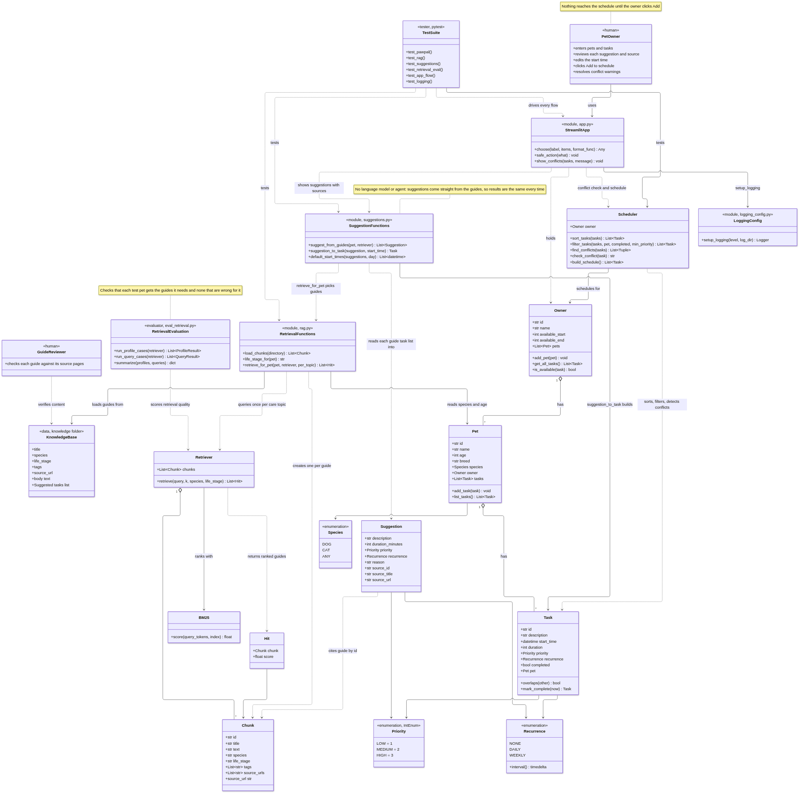

# PawPal+ with RAG: care suggestions grounded in sourced guides

This project extends the original **PawPal+ (without RAG)**, which is described next.

## Original project: PawPal+ (without RAG)

PawPal+ was a Streamlit scheduling assistant for busy pet owners. Its goal was to let an owner track care tasks (walks, feeding, medication, grooming) for one or more pets and turn them into a daily plan that respects priority and the owner's available hours. It could sort and filter tasks, detect overlapping tasks across pets, repeat daily and weekly tasks automatically, and was covered by 26 automated tests. Its full documentation is in [docs/original_pawpal.md](docs/original_pawpal.md).

## Current project: PawPal+ with RAG

**What it does.** The original scheduler still works, and the app now also answers a question the owner usually has first: *what care does my pet actually need?* You add a pet with its species and age, and PawPal+ **retrieves** the matching pages from a knowledge base of 12 care guides (feeding, exercise, vaccines, grooming, medication and safety for dogs and cats, plus puppy and senior care). It turns those guides' task lists into suggestions, each showing its **source link**. You review them, adjust the start time, and add the ones you want to your schedule, where the original conflict checking applies.

**Why it matters.** New pet owners often don't know what a puppy or a 12-year-old cat needs, and generic advice online is hard to trust. Here every suggestion traces back to a named source, the guides were checked against those sources by hand, and nothing reaches the schedule until the owner clicks Add.

## Architecture overview



The diagram ([Mermaid source](diagrams/system_diagram.mmd)) is a class diagram of the whole system. Reading it by stage:

- **Input:** the owner enters a pet (species, age, breed) in the Streamlit app, and the 12 guides sit in `knowledge/`, each with a source URL.
- **Process:** `rag.py` turns the pet into a life stage (puppy, adult, senior) and runs one query per care topic. The `Retriever` ranks guides with BM25 and drops any that don't fit the pet's species or life stage. `suggestions.py` reads each retrieved guide's "Suggested tasks" list into cited `Suggestion` objects, and the original `Scheduler` sorts tasks and finds conflicts.
- **Output:** suggestion cards with sources, and a daily schedule with conflict warnings.
- **Where people and tests check the results:** the owner reviews every suggestion and its source before clicking Add and decides what to do about conflicts. A person checked each guide against its source pages. The `pytest` suite and a retrieval evaluation (`eval_retrieval.py`) check the code and the retrieval quality, and `logs/pawpal.log` records what the system did.

## Setup

**Requirements:** Python 3.9 or newer (developed and tested on 3.13). No API key, account or internet connection is needed once the packages are installed.

Run these from the project folder, the one that contains `app.py`.

1. **Create a virtual environment:**

   ```bash
   python -m venv .venv
   ```

2. **Activate it.** Your prompt should start with `(.venv)` afterward.

   | Shell | Command |
   |-------|---------|
   | Windows PowerShell | `.venv\Scripts\Activate.ps1` |
   | Windows Command Prompt | `.venv\Scripts\activate.bat` |
   | macOS / Linux | `source .venv/bin/activate` |

   If PowerShell says scripts are disabled, run `Set-ExecutionPolicy -Scope Process RemoteSigned` once in that window and try again.

3. **Install the dependencies** (Streamlit and pytest):

   ```bash
   pip install -r requirements.txt
   ```

4. **Check that it works.** All tests should pass:

   ```bash
   python -m pytest -q
   ```

5. **Run it** (activate the environment first in any new terminal):

   | What | Command |
   |------|---------|
   | Web app (opens at <http://localhost:8501>) | `streamlit run app.py` |
   | Command-line demo of the scheduler | `python main.py` |
   | Retrieval evaluation report | `python eval_retrieval.py` |
   | Example inputs and outputs (no browser needed) | `python demo.py` |
   | Live guardrail checks (exits 1 if any fail) | `python demo.py guardrails` |
   | Regenerate the saved execution evidence | `python make_evidence.py` |

   In the app: add a pet and choose its **species**, click **Suggest care tasks**, click **Add to schedule** on the tasks you want, then **Generate schedule**. Click Generate again after adding more tasks.

**If something goes wrong:** `streamlit` not recognized means the environment isn't active (or use `python -m streamlit run app.py`). `ModuleNotFoundError` means you're not in the project folder. Port in use: add `--server.port 8502`. Details of any error are in `logs/pawpal.log`; set `PAWPAL_LOG_LEVEL=DEBUG` for more.

## Sample interactions

Run `python demo.py` to reproduce these. They are real outputs, not mock-ups. There is no language model, so the same input always gives the same output. Full file: [docs/evidence/demo_interactions_output.txt](docs/evidence/demo_interactions_output.txt).

```bash
python demo.py
```

<!-- evidence:demo_interactions -->
```text

=== Example 1: an adult dog ===
Input:  species=dog  age=3  breed='Golden Retriever'  existing tasks: none  (life stage: adult)
Output: 10 suggestions, the first six shown
  Breakfast feeding                       10 min  HIGH    daily   <- Dog Feeding Frequency
  Dinner feeding                          10 min  HIGH    daily   <- Dog Feeding Frequency
  Morning walk                            30 min  HIGH    daily   <- Dog Exercise Needs
  Evening walk                            20 min  MEDIUM  daily   <- Dog Exercise Needs
  Play or training session                15 min  LOW     daily   <- Dog Exercise Needs
  Vaccination booster appointment         45 min  HIGH    none    <- Dog Vaccinations and Preventive Care

=== Example 2: a puppy gets extra, stage-specific tasks ===
Input:  species=dog  age=0  breed='Labrador'  (life stage: puppy)
Output: 13 suggestions: the adult dog's 10, plus
  Puppy meals                             10 min  HIGH    daily   <- Puppy Care Basics
  Short play or training session          10 min  MEDIUM  daily   <- Puppy Care Basics
  Vet vaccination visit                   45 min  HIGH    none    <- Puppy Care Basics
  contains 'Senior wellness exam': False

=== Example 3: a senior cat ===
Input:  species=cat  age=12  breed='Tabby'  (life stage: senior)
Output: 14 suggestions, including
  Senior wellness exam                    60 min  HIGH    none    <- Senior Pet Care
  Scoop litter box                         5 min  HIGH    daily   <- Cat Litter Box and Grooming
  Flea preventive                          5 min  HIGH    none    <- Cat Vaccinations and Preventive Care
  source: https://vcahospitals.com/resources/senior/when-is-your-pet-considered-a-senior
  contains 'Kitten vaccination visit': False
  contains any dog guide: False

=== Example 4: searching the guides with a question ===
Input:  "can my dog eat chocolate or grapes"
Output:
  1. toxic_foods_and_hazards            score 8.50
  2. dog_feeding                        score 2.04
  3. puppy_care                         score 1.35
Input:  "when does my kitten need its shots"
Output:
  1. cat_enrichment_play                score 2.81
  2. cat_vaccinations_preventive_care   score 2.52
  3. cat_feeding                        score 2.43
  (the second question is a known weak spot: keyword search ranks the play guide above the vaccine guide, because the guide says 'vaccines', not 'shots')

=== Example 5: a conflict is warned about, not blocked ===
Input:  existing task 'Vet check-up' 08:00-09:00; add suggested 'Breakfast feeding' at 08:15
Output: 'Breakfast feeding' (Buddy, 08:15-08:25) overlaps 'Vet check-up' (Buddy, 08:00-09:00) (same pet)
        the task was still added: Buddy now has 2 tasks
```
<!-- /evidence:demo_interactions -->

## Reproducible execution evidence

Everything below was produced by running the commands shown, and nothing was edited by hand. `python make_evidence.py` re-runs them, saves each full output to [docs/evidence/](docs/evidence/) with a header (command, date, Python version, exit code), and refreshes the blocks in this README, so a grader can check the results without running anything.

| Command | What it shows | Saved output |
|---------|---------------|--------------|
| `python -m pytest -v` | every automated test, including the ones that drive the real page | [pytest_output.txt](docs/evidence/pytest_output.txt) |
| `python eval_retrieval.py` | retrieval quality on 7 test pets and 19 questions | [eval_retrieval_output.txt](docs/evidence/eval_retrieval_output.txt) |
| `python demo.py` | example inputs and outputs (above) | [demo_interactions_output.txt](docs/evidence/demo_interactions_output.txt) |
| `python demo.py guardrails` | live checks of the filters and safety behavior | [demo_guardrails_output.txt](docs/evidence/demo_guardrails_output.txt) |
| `python main.py` | the original scheduler demo | [scheduler_cli_output.txt](docs/evidence/scheduler_cli_output.txt) |

### Reliability and guardrail results

<!-- evidence:reliability -->
| What was checked | Result | Full output |
|------------------|--------|-------------|
| Automated tests | 145 passed in 7.47s | [pytest_output.txt](docs/evidence/pytest_output.txt) |
| Test pets get the right guides and no wrong ones | 7 of 7, with 0 wrong guides | [eval_retrieval_output.txt](docs/evidence/eval_retrieval_output.txt) |
| Questions find an acceptable guide | right guide first for 95%, in the top 3 for 100% of 19 | [eval_retrieval_output.txt](docs/evidence/eval_retrieval_output.txt) |
| Guardrail checks | 10 of 10 passed | [demo_guardrails_output.txt](docs/evidence/demo_guardrails_output.txt) |
<!-- /evidence:reliability -->

### Automated tests

`python -m pytest -v` (start and end of the output; the full listing is in [pytest_output.txt](docs/evidence/pytest_output.txt)):

<!-- evidence:pytest -->
```text
$ python -m pytest -v -p no:cacheprovider
# generated 2026-11-16 by make_evidence.py | Python 3.13.15 | exit code 0

============================= test session starts =============================
platform win32 -- Python 3.13.15, pytest-9.2.0, pluggy-1.7.0 -- <project>\.venv\Scripts\python.exe
rootdir: <project>
plugins: anyio-4.16.0
collecting ... collected 145 items
...
tests/test_suggestions.py::test_default_start_times_are_back_to_back_from_8am PASSED [ 99%]
tests/test_suggestions.py::test_default_start_times_never_spill_past_the_day PASSED [100%]

============================= 145 passed in 7.47s =============================
```
<!-- /evidence:pytest -->

Tests passed per file, counted from that output:

<!-- evidence:pytest_files -->
| Test file | Passed | Failed |
|-----------|-------:|-------:|
| `tests/test_app_flow.py` | 9 | 0 |
| `tests/test_app_suggestions.py` | 10 | 0 |
| `tests/test_demo.py` | 15 | 0 |
| `tests/test_guide_suggestions.py` | 24 | 0 |
| `tests/test_logging.py` | 18 | 0 |
| `tests/test_pawpal.py` | 27 | 0 |
| `tests/test_rag.py` | 27 | 0 |
| `tests/test_retrieval_eval.py` | 12 | 0 |
| `tests/test_suggestions.py` | 3 | 0 |
<!-- /evidence:pytest_files -->

### Retrieval evaluation

`python eval_retrieval.py` scores whether each test pet gets the guides it needs and none that are wrong for it, and whether each question finds an acceptable guide:

<!-- evidence:eval -->
```text
Profile cases (12 guides in the knowledge base)
  PASS  adult dog (3)
  PASS  puppy (0)
  PASS  senior dog (10)
  PASS  adult cat (4)
  PASS  kitten (0)
  PASS  senior cat (12)
  PASS  unknown species, adult (3)

Query cases: 19 lines omitted here, see the full file

Summary
  profile_cases: 7
  profile_cases_passed: 7
  profile_recall: 1.00
  wrong_guides: 0
  query_cases: 19
  hit_at_1: 0.95
  hit_at_3: 1.00
  mrr: 0.97
```
<!-- /evidence:eval -->

### Guardrail checks

`python demo.py guardrails` runs each check live. These are the safeguards that matter most: the species and life-stage filters, the duplicate and limit checks, safe handling of bad or missing knowledge files, conflicts that warn but never block, and keeping private data out of the logs. Error containment in the web page is covered by the tests in `tests/test_app_flow.py`.

<!-- evidence:guardrails -->
```text
PawPal+ guardrail checks (live)
  PASS  Species filter: dog gets 6 guides, none cat; cat gets 6 guides, none dog
  PASS  Life-stage filter: puppy gets puppy_care only; senior gets senior_pet_care only; adult gets neither
  PASS  Wrong-stage tasks left out: a 12-year-old cat is offered 'Senior wellness exam', not 'Kitten vaccination visit'
  PASS  Duplicates skipped: existing 'morning WALK' is not suggested again, and no suggestion repeats
  PASS  Limits and citations: 113 suggestions across 9 pet profiles: durations 1-240 min, each with an https source
  PASS  Citation URLs intact: all 12 guides parse with a source URL (including one containing '---')
  PASS  Bad knowledge files handled: an unreadable and an empty guide are skipped and logged; the good one still loads
  PASS  Missing knowledge folder handled: a missing knowledge folder gives no suggestions and an error log, not a crash
  PASS  Conflicts warn, never block: an overlapping task produces a warning and is still added
  PASS  No private data in logs: 9 DEBUG log lines written; pet name, breed and task text absent

10/10 guardrail checks passed
App-level error containment and logging of user actions are covered by tests/test_app_flow.py and tests/test_logging.py (see the pytest output).
```
<!-- /evidence:guardrails -->

### The original scheduler demo

`python main.py` (the original PawPal+ scheduling features, unchanged):

<!-- evidence:scheduler_cli -->
```text
Today's Schedule for Chelsea - Monday, November 16, 2026
============================================================
07:30-08:00  Morning walk         Buddy      HIGH
08:00-08:15  Breakfast feeding    Whiskers   MEDIUM
14:00-15:00  Vet check-up         Buddy      HIGH
14:00-14:10  Medication           Whiskers   HIGH
18:30-18:50  Grooming             Whiskers   LOW

Conflicts:
  WARNING: 'Vet check-up' (Buddy, 14:00-15:00) overlaps 'Medication' (Whiskers, 14:00-14:10) (different pets)
```
<!-- /evidence:scheduler_cli -->

## Design decisions

- **Retrieval plus curated task lists, not an LLM writing the advice.** It needs no key, gives identical results every time, and every suggestion traces to a source. The trade-off: suggestions are generic, with a canned reason, and aren't tailored to the pet's situation.
- **Plain BM25 keyword search, no embeddings.** It is simple and easy to test offline. The trade-off: it can't connect different wording ("shots" and "vaccines").
- **12 hand-checked guides for dogs and cats only.** The content is trustworthy, but it's small and covers no other animals.
- **The owner stays in control.** Suggestions are proposals, and conflicts warn but never block. The trade-off is a few more clicks.

## Testing summary

- **What worked:** <!-- evidence:test_count -->145 tests pass (the 26 original plus 119 new)<!-- /evidence:test_count -->, including tests that drive the real page. Results and full output are in [Reproducible execution evidence](#reproducible-execution-evidence).
- **What didn't, at first:**
  - Filler words like "my" and "should" outranked the one meaningful word in a question.
  - Selectboxes handed back copies of pets, so added tasks silently vanished. Only tests that drove the real page found it.
  - My first drafts of the guides contained claims their sources didn't support.
- **Still weak:** "when does my kitten need its shots" ranks the play guide first and the vaccine guide second. The evaluation is also small and I wrote it myself, so its scores are optimistic.
- **What I learned:** the bugs that mattered showed up in realistic end-to-end use, not in the neat unit tests.

## Reflection

This project taught me that an AI assistant can produce something that looks finished long before it is correct: my first guide drafts read well but misquoted their sources, and only reading the actual pages caught it. It also taught me to test the real thing, not a stand-in. Mocks and unit tests passed while the real page was losing tasks. Finally, I learned that removing a feature can be the better engineering. A language-model step I couldn't verify live was worse than a simpler, traceable one I could test completely.

## More documentation

- [Original PawPal+ (without RAG)](docs/original_pawpal.md): scheduler design, features and demo
- [Execution evidence](docs/evidence/): saved output of every command above, regenerated by `make_evidence.py`
- [Knowledge base notes](knowledge/README.md): guide format and how each was verified
- Diagrams: [system diagram](diagrams/system_diagram.mmd), [original UML](diagrams/uml_final.mmd)
- [reflection.md](reflection.md) and [ai_interactions.md](ai_interactions.md): project reflections
